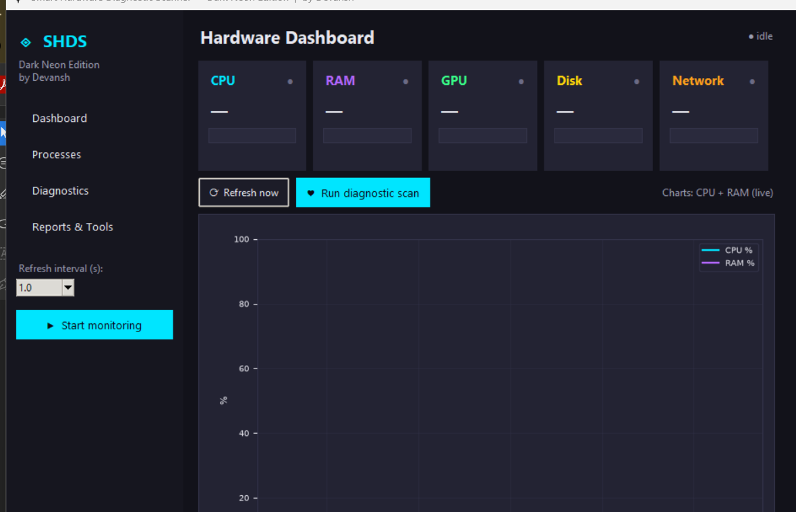
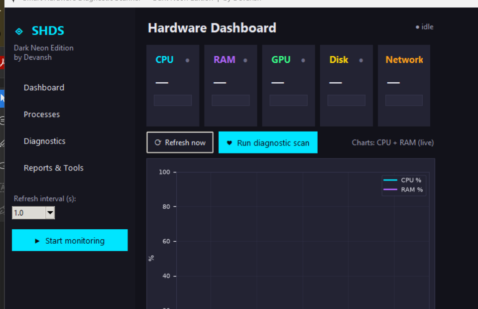

# 🖥️ WARECARE — Smart Hardware Diagnostic & Predictive Health Scanner

<p align="center">
  <strong>A Comprehensive Desktop-Based Hardware Monitoring, System Diagnostics & Predictive Health Platform</strong>
</p>

<p align="center">
  
</p>

<p align="center">
  
  
  
  
  
  
</p>

---

## 📌 Table of Contents

- [1. Introduction](#-1-introduction)
- [2. Project Overview](#-2-project-overview)
- [3. Problem Statement](#-3-problem-statement)
- [4. Project Objectives](#-4-project-objectives)
- [5. Key Features](#-5-key-features)
- [6. Application Modules](#-6-application-modules)
- [7. Technology Stack](#-7-technology-stack)
- [8. System Architecture](#-8-system-architecture)
- [9. Complete Project Structure](#-9-complete-project-structure)
- [10. Module Documentation](#-10-module-documentation)
- [11. Installation and Setup](#-11-installation-and-setup)
- [12. Running the Application](#-12-running-the-application)
- [13. Command-Line Interface](#-13-command-line-interface)
- [14. Diagnostic Engine](#-14-diagnostic-engine)
- [15. Predictive Health Engine](#-15-predictive-health-engine)
- [16. Database and Data Storage](#-16-database-and-data-storage)
- [17. Report Generation](#-17-report-generation)
- [18. Supported Operating Systems](#-18-supported-operating-systems)
- [19. Hardware Monitoring Limitations](#-19-hardware-monitoring-limitations)
- [20. Testing](#-20-testing)
- [21. Building a Windows Executable](#-21-building-a-windows-executable)
- [22. Security and Reliability](#-22-security-and-reliability)
- [23. Screenshots](#-23-screenshots)
- [24. Future Development](#-24-future-development)
- [25. Contributing](#-25-contributing)
- [26. Acknowledgements](#-26-acknowledgements)

---

# 🚀 1. Introduction

**WARECARE** is a Python-based desktop hardware monitoring and diagnostic platform designed to help users understand, monitor, and evaluate the operational health of their computer systems.

The application combines real-time hardware monitoring, configurable diagnostic rules, system-level error detection, predictive health analysis, and automated report generation into a unified desktop interface.

Instead of relying on multiple independent utilities to inspect CPU usage, memory consumption, disk health, network activity, running processes, and operating system errors, WARECARE brings these capabilities together in one application.

The platform provides both a modular Python implementation and a standalone application build.

Its interface uses a modern dark-neon visual design with a light-mode alternative, interactive dashboard components, diagnostic summaries, charts, and detailed system reports.

The project is designed around three fundamental principles:

1. **Monitoring:** Collect and display actual hardware and system information.
2. **Diagnostics:** Evaluate collected information using documented thresholds and diagnostic rules.
3. **Prediction:** Use historical performance data to identify trends, detect anomalies, and estimate future resource pressure.

WARECARE aims to make system health information more accessible, understandable, and actionable without automatically modifying the user's computer.

---

# 🎯 2. Project Overview

| Attribute | Details |
|---|---|
| Project Name | WARECARE |
| Application | Smart Hardware Diagnostic Scanner |
| Project Type | Desktop Application |
| Programming Language | Python |
| GUI Framework | CustomTkinter / Tkinter |
| Database | SQLite |
| Monitoring Library | psutil |
| Visualization | Matplotlib (optional) |
| Image Processing | Pillow |
| Predictive Analysis | Statistical forecasting |
| Architecture | Modular + Standalone |
| Primary Platform | Windows 11 |
| Additional Platforms | Linux and macOS |
| Minimum Python Version | Python 3.11 |

### Main Application Components

WARECARE contains two primary application implementations:

**1. Standalone Application**

Located at:

`Warecare/ewarecare.py`

This is the consolidated single-file implementation of the application. Its PyInstaller configuration is provided through `ewarecare.spec`.

**2. Modular Application**

Located at:

`Warecare/smart_hardware_diagnostic_scanner/`

This implementation separates the application into individual modules responsible for hardware collection, diagnostics, reporting, monitoring, predictive analysis, and graphical interface management.

The modular implementation also includes a separate single-file GUI build named `shds_gui.py`.

---

# ❗ 3. Problem Statement

Computer systems continuously generate large amounts of hardware and operating system information. However, understanding this information and identifying potential performance problems can be difficult for ordinary users.

Common problems include:

- Excessive CPU utilization.
- High RAM consumption.
- Insufficient disk storage.
- Abnormal hardware temperatures.
- GPU monitoring difficulties.
- Unexpected application crashes.
- Background processes consuming excessive resources.
- Failed operating system services.
- Hardware-related system errors.
- Lack of historical performance information.
- Difficulty understanding diagnostic results.
- No centralized way to export system health reports.

Traditional monitoring utilities frequently focus on individual components rather than providing a unified diagnostic experience.

Additionally, a system may appear healthy at one moment while its historical resource utilization indicates an emerging problem.

WARECARE addresses these challenges through an integrated monitoring and diagnostic platform that combines current hardware information with historical data and statistical analysis.

---

# 🎯 4. Project Objectives

The primary objectives of WARECARE are:

### 4.1 Hardware Monitoring

- Monitor CPU utilization and individual CPU cores.
- Monitor physical memory consumption.
- Collect GPU information when supported.
- Monitor disk capacity and disk activity.
- Track network interface activity.
- Display available temperature sensor readings.
- Monitor battery information where supported.

### 4.2 System Diagnostics

- Evaluate system metrics using configurable thresholds.
- Identify abnormal resource utilization.
- Detect selected operating system errors.
- Generate diagnostic findings.
- Classify findings according to severity.
- Provide understandable explanations and recommendations.

### 4.3 Predictive Analysis

- Maintain historical hardware performance records.
- Analyze resource utilization trends.
- Estimate disk capacity exhaustion.
- Detect unusual performance patterns.
- Generate future health projections when sufficient data is available.

### 4.4 Reporting

- Export diagnostic results.
- Generate structured JSON reports.
- Generate readable text reports.
- Generate CSV reports.
- Generate self-contained HTML reports.
- Compare current diagnostic results with previous scans.

### 4.5 User Experience

- Provide a centralized graphical interface.
- Offer dark and light visual themes.
- Display interactive performance charts.
- Provide a responsive monitoring experience.
- Make diagnostic results understandable to non-technical users.

---

# ✨ 5. Key Features

## 5.1 Real-Time Hardware Monitoring

WARECARE collects hardware information and presents it through a centralized dashboard.

Supported monitoring categories include:

| Component | Monitored Information |
|---|---|
| CPU | Overall utilization, per-core utilization, core counts and frequency |
| RAM | Total, available, used memory and utilization |
| GPU | Available GPU information and supported metrics |
| Disk | Partition capacity, free space, usage and disk I/O |
| Network | Network interfaces, transmitted and received bytes, transfer rates |
| Battery | Charge level, power state and estimated remaining time |
| Sensors | Available temperature readings |
| Processes | Process ID, name, CPU usage and memory consumption |

The application uses actual collected information rather than generating placeholder hardware measurements.

Unavailable hardware information is explicitly identified.

## 5.2 Live Performance Monitoring

- Start and stop live monitoring.
- Configure refresh intervals.
- Display CPU and RAM trends.
- View per-core CPU utilization.
- Monitor disk read/write throughput.
- Monitor network activity.
- Receive threshold-based alerts.

Supported refresh intervals include:

- 0.5 seconds
- 1 second
- 2 seconds
- 5 seconds

## 5.3 System Health Score

WARECARE provides an overall System Health score ranging from 0 to 100.

The modular diagnostic implementation combines:

| Component | Weight |
|---|---:|
| CPU | 30% |
| RAM | 25% |
| Worst disk | 25% |
| Operating system findings | 20% |

Unavailable metrics are excluded and the remaining weights are normalized.

Operating system findings are incorporated after a diagnostic scan has been performed.

The score is intended as a summary of the application's diagnostic checks, not a certified hardware health measurement.

## 5.4 Diagnostic Scanning

The diagnostic engine evaluates available hardware and operating system information.

Each finding is assigned one of four statuses:

- `PASS` — The check is within its configured acceptable range.
- `WARNING` — A potentially problematic condition has been detected.
- `FAIL` — A configured critical threshold or diagnostic condition has been reached.
- `UNAVAILABLE` — The application cannot obtain reliable information for the check.

## 5.5 GPU Detection

GPU information can be collected through available vendor utilities:

- NVIDIA: `nvidia-smi`
- AMD: `rocm-smi`
- Intel: `intel_gpu_top`

The application does not invent GPU information when the required hardware utility or driver is unavailable.

## 5.6 Process Management and Inspection

The Processes page provides information about currently running processes.

Users can inspect:

- Process ID.
- Process name.
- CPU consumption.
- Memory consumption.
- Executable path.
- Command-line information.
- User information.
- Threads.
- Child processes.
- Available network connections.
- Open files.

Process information is collected for inspection. The documented application functionality does not imply automatic process termination.

## 5.7 Operating System Diagnostics

WARECARE includes platform-specific read-only checks.

Examples include:

**Windows**
- Windows Update service status.
- Microsoft Defender real-time protection.
- System Restore policy.

**Linux**
- Hardware-related kernel messages.
- Inode utilization.
- Failed systemd services.

**macOS**
- Recent unified-log errors.
- Time Machine backup information.

Missing commands and insufficient permissions are handled as unavailable diagnostic results.

## 5.8 Error Explainer

Diagnostic findings can be accompanied by explanations describing:

- What the finding means.
- Why it may have occurred.
- What the potential impact is.
- What the user can do to investigate it.

The application provides safe, user-initiated actions rather than silently applying system modifications.

## 5.9 Historical Scan Comparison

The application can compare diagnostic findings between scans.

Comparison categories include:

- Regressions.
- Improvements.
- Newly detected findings.
- Resolved findings.

This helps users understand whether system conditions are improving or deteriorating over time.

## 5.10 Predictive Health

The predictive engine uses historical resource measurements to:

- Estimate future disk utilization.
- Forecast resource trends.
- Detect statistical anomalies.
- Evaluate possible performance degradation.
- Generate future health projections.

Predictions depend on the quality and quantity of available historical data.

## 5.11 Report Generation

WARECARE supports multiple report formats:

| Format | Purpose |
|---|---|
| JSON | Structured diagnostic data |
| TXT | Human-readable diagnostic summaries |
| CSV | Tabular information for analysis |
| HTML | Formatted standalone diagnostic reports |

The modular reporting implementation is maintained in `scanner/reports.py`.

## 5.12 User Interface

The application provides:

- Dark-neon interface.
- Light theme.
- Sidebar navigation.
- Hardware dashboard cards.
- Progress indicators.
- Status indicators.
- Interactive charts where supported.
- Diagnostic result panels.
- Report export controls.

---

# 🧩 6. Application Modules

The modular application organizes its functionality into several major subsystems.

| Subsystem | Responsibility |
|---|---|
| Dashboard | Displays system health and live metrics |
| Hardware Collector | Retrieves hardware information |
| GPU Detector | Identifies supported GPU information |
| Monitoring Engine | Collects periodic hardware samples |
| Diagnostic Engine | Evaluates system conditions |
| Error Explainer | Explains diagnostic findings |
| Predictive Engine | Analyzes historical metrics |
| Crash Analyzer | Handles crash-related information |
| Process Viewer | Displays process information |
| Connection Viewer | Inspects network connections |
| Startup Viewer | Inspects startup entries |
| SMART Monitor | Queries supported disk health information |
| Reporting Engine | Generates diagnostic reports |
| Scheduling Engine | Configures scheduled scans |
| Database Layer | Stores historical performance information |
| Theme Engine | Manages application appearance |

---

# 🛠️ 7. Technology Stack

## Programming Language

**Python 3.11+**

Python is used for hardware monitoring, operating system interaction, diagnostic processing, statistical analysis, database operations, and graphical interface development.

## Core Technologies

| Technology | Usage |
|---|---|
| Python | Main application language |
| CustomTkinter | Modern desktop UI |
| Tkinter | GUI foundation |
| psutil | System and process monitoring |
| SQLite | Historical data storage |
| Pillow | Image handling |
| Matplotlib | Optional performance charts |
| PyInstaller | Windows executable packaging |
| pytest | Automated testing |

## Standard Python Libraries

The application also uses Python's standard library for:

- `threading` — Background execution.
- `queue` — Thread-safe communication.
- `subprocess` — Operating system utility execution.
- `sqlite3` — Database operations.
- `json` — Structured data handling.
- `csv` — CSV report generation.
- `logging` — Application logging.
- `socket` — Network information.
- `platform` — Operating system detection.
- `statistics` — Statistical analysis.
- `datetime` — Time and historical measurements.
- `pathlib` — Filesystem path handling.

---

# 🏗️ 8. System Architecture

WARECARE follows a modular desktop application architecture.

The major processing stages are:

```text
                 WARECARE APPLICATION
                          |
                          |
                USER INTERFACE LAYER
                          |
               +----------+----------+
               |          |          |
           Dashboard   Processes  Diagnostics
               |          |          |
               +----------+----------+
                          |
                          |
                APPLICATION SERVICES
                          |
          +---------------+---------------+
          |               |               |
      Monitoring      Diagnostics     Reporting
          |               |               |
          |               |               |
      Hardware        Rule Engine      Export Engine
      Collection      Thresholds       JSON / TXT
          |           OS Checks        CSV / HTML
          |               |
          +---------------+
                  |
                  |
             DATA LAYER
                  |
          +-------+-------+
          |               |
        SQLite        System APIs
          |
          |
     Historical Metrics
          |
          |
     Predictive Engine
          |
          |
    Forecasts and Anomalies
```

## Architecture Explanation

### Layer 1: Presentation

The presentation layer provides the graphical interface through CustomTkinter and Tkinter.

It displays hardware measurements, diagnostic results, charts, and application controls.

### Layer 2: Application Services

This layer coordinates monitoring, diagnostic execution, report generation, process inspection, and other application functions.

### Layer 3: Hardware Collection

Hardware information is collected using system interfaces and supported monitoring utilities.

### Layer 4: Diagnostic Processing

Collected measurements are evaluated using configured thresholds and platform-specific checks.

### Layer 5: Data Persistence

Historical performance measurements and related information are stored in SQLite.

### Layer 6: Predictive Analysis

Historical information is processed by statistical forecasting and anomaly-detection functions.

---

# 📂 9. Complete Project Structure

The following structure reflects the repository's source organization. Generated Python cache files and compiled bytecode are intentionally excluded.

```text
WARECARE_NEW_3/
│
├── README.md
│
└── Warecare/
    │
    ├── README.md
    │
    ├── ewarecare.py
    ├── ewarecare.spec
    │
    ├── tests/
    │   ├── test_crashlog.py
    │   ├── test_metrics_db.py
    │   ├── test_predictive.py
    │   ├── test_predictive_glue.py
    │   ├── test_standalone_edge_cases.py
    │   ├── test_standalone_threading.py
    │   └── test_standalone_ui.py
    │
    └── smart_hardware_diagnostic_scanner/
        │
        ├── README.md
        │
        ├── main.py
        ├── shds_gui.py
        │
        ├── requirements.txt
        ├── requirements-optional.txt
        ├── requirements-dev.txt
        │
        ├── Open Smart Hardware Scanner.bat
        ├── shds.sh
        ├── shds.spec
        │
        ├── screenshots/
        │   ├── dashboard_default.png
        │   └── dashboard_min.png
        │
        ├── scanner/
        │   │
        │   ├── __init__.py
        │   │
        │   ├── actions.py
        │   ├── app.py
        │   ├── charts.py
        │   ├── crashlog.py
        │   ├── ctk_widgets.py
        │   ├── diagnostics.py
        │   ├── explainer.py
        │   ├── filesutil.py
        │   ├── gpu.py
        │   ├── hardware.py
        │   ├── icons.py
        │   ├── logging_config.py
        │   ├── metrics_db.py
        │   ├── monitoring.py
        │   ├── netview.py
        │   ├── predictive.py
        │   ├── reports.py
        │   ├── scheduler.py
        │   ├── smart.py
        │   ├── startup.py
        │   ├── theme.py
        │   └── updater.py
        │
        └── tests/
            │
            ├── __init__.py
            ├── test_actions.py
            ├── test_app.py
            ├── test_diagnostics.py
            ├── test_explainer.py
            ├── test_features.py
            ├── test_filesutil.py
            ├── test_gpu.py
            ├── test_hardware.py
            ├── test_logging_config.py
            ├── test_netview.py
            ├── test_regressions.py
            ├── test_reports.py
            ├── test_scheduler.py
            ├── test_shds_gui.py
            ├── test_smart.py
            ├── test_startup.py
            ├── test_theme.py
            └── test_updater.py
```

---

# 📖 10. Module Documentation

This section describes the responsibilities of the individual modules.

## 10.1 Main Application

### `main.py`

The primary entry point for the modular desktop application.

Responsibilities:

- Initializes the scanner package path.
- Loads the graphical application.
- Configures application logging.
- Handles startup errors.
- Displays error dialogs when initialization fails.

### `shds_gui.py`

A consolidated single-file implementation of the Smart Hardware Diagnostic Scanner.

It includes:

- GUI implementation.
- Hardware collection.
- Monitoring.
- Diagnostics.
- Reporting.
- Optional chart support.
- Command-line scanning.
- Historical scan functionality.
- Configuration handling.

### `ewarecare.py`

The standalone WARECARE application build.

It consolidates the theme, utilities, hardware collectors, diagnostic engine, and CustomTkinter interface into a single Python module.

### `ewarecare.spec`

PyInstaller specification for packaging `ewarecare.py` into a Windows executable.

## 10.2 Scanner Package

### `scanner/__init__.py`

Initializes the scanner package.

### `scanner/app.py`

Contains the main modular graphical application.

Responsibilities:

- Application initialization.
- Navigation.
- Dashboard management.
- GUI event handling.
- Monitoring integration.
- Diagnostic integration.
- Process and connection views.
- Report and tool interfaces.

### `scanner/hardware.py`

Handles hardware information collection.

Collects available information about:

- CPU.
- Memory.
- Disk partitions.
- Network interfaces.
- Temperatures.
- Hardware snapshots.

### `scanner/gpu.py`

Handles GPU detection and supported GPU metric collection.

Uses available vendor utilities to identify GPU information.

### `scanner/monitoring.py`

Implements background monitoring functionality.

Provides periodic system samples and communication between monitoring workers and the GUI.

### `scanner/diagnostics.py`

Contains the diagnostic engine.

Responsibilities:

- Configurable diagnostic thresholds.
- CPU diagnostics.
- Memory diagnostics.
- Disk diagnostics.
- Hardware findings.
- Diagnostic report generation.
- System Health scoring.
- Comparison between diagnostic scans.

### `scanner/actions.py`

Contains diagnostic action and rule-handling functionality.

Provides metric labels, action rules, and rule evaluation.

### `scanner/explainer.py`

Provides explanatory information for diagnostic findings and crash-related events.

### `scanner/predictive.py`

Contains statistical prediction and anomaly-detection functionality.

Responsibilities:

- Linear regression.
- Disk capacity forecasting.
- Resource forecasting.
- Anomaly detection.
- Health score forecasting.
- Predictive health summaries.

### `scanner/metrics_db.py`

Implements the SQLite historical metrics storage layer.

Stores:

- CPU measurements.
- RAM measurements.
- Disk utilization.
- Historical event annotations.

Also provides historical metric queries and hourly aggregated data.

### `scanner/crashlog.py`

Contains crash-related log analysis functionality.

### `scanner/reports.py`

Handles report construction, formatting, exporting, and diagnostic comparison HTML generation.

### `scanner/charts.py`

Provides chart-related functionality when Matplotlib is available.

### `scanner/ctk_widgets.py`

Contains reusable CustomTkinter interface components.

### `scanner/theme.py`

Centralizes the application's visual theme configuration.

Supports dark and light palettes.

### `scanner/icons.py`

Contains application icon and navigation icon definitions.

### `scanner/logging_config.py`

Configures application logging and log file management.

### `scanner/netview.py`

Collects network connection information and associates connections with owning processes when available.

### `scanner/startup.py`

Inspects startup entries across supported operating systems.

### `scanner/smart.py`

Handles optional SMART disk-health queries through `smartctl`.

### `scanner/scheduler.py`

Contains scheduled scanning functionality.

Supports Windows Task Scheduler and Linux/macOS cron integration.

### `scanner/filesutil.py`

Contains filesystem utility functions, including largest-file discovery.

### `scanner/updater.py`

Provides manual update-check functionality using release metadata.

### `scanner/utils.py`

Contains shared utility functions used throughout the application.

---

# ⚙️ 11. Installation and Setup

## 11.1 Prerequisites

Before installing WARECARE, ensure that you have:

- Python 3.11 or newer.
- Git.
- A supported operating system.
- A working Python installation.
- Tkinter support.
- Internet access for installing dependencies.

Python can be downloaded from:

https://www.python.org/downloads/

Git can be downloaded from:

https://git-scm.com/downloads

## 11.2 Clone the Repository

Open your terminal, PowerShell, or Zed integrated terminal.

```bash
git clone https://github.com/innovativedev-developer/WARECARE_NEW_3.git
```

Navigate to the repository:

```bash
cd WARECARE_NEW_3
```

Navigate to the modular application:

```bash
cd Warecare/smart_hardware_diagnostic_scanner
```

## 11.3 Create a Virtual Environment

### Windows PowerShell

```powershell
py -3 -m venv .venv
```

Activate the environment:

```powershell
.\.venv\Scripts\Activate.ps1
```

If PowerShell prevents script execution, use:

```powershell
Set-ExecutionPolicy -Scope CurrentUser RemoteSigned
```

Then activate the environment again.

### Linux / macOS

```bash
python3 -m venv .venv
```

Activate:

```bash
source .venv/bin/activate
```

## 11.4 Upgrade pip

```bash
python -m pip install --upgrade pip
```

## 11.5 Install Dependencies

Install core dependencies:

```bash
pip install -r requirements.txt
```

Install optional features:

```bash
pip install -r requirements-optional.txt
```

Install development dependencies:

```bash
pip install -r requirements-dev.txt
```

### Dependency Overview

**Core dependencies**

```text
psutil>=5.9
customtkinter>=5.2
Pillow>=10.0
```

**Optional dependencies**

```text
matplotlib>=3.7
plyer>=2.1
```

**Development dependencies**

```text
pytest>=7.0
pyinstaller>=6.0
```

The development requirements file includes the core requirements.

Matplotlib and Plyer are optional. The application is designed to degrade gracefully when these optional packages are unavailable.

---

# ▶️ 12. Running the Application

There are multiple ways to launch WARECARE.

## Option 1: Modular Application

Navigate to:

```bash
cd Warecare/smart_hardware_diagnostic_scanner
```

Run:

```bash
python main.py
```

This launches the modular application using the `scanner/` package.

## Option 2: Single-File GUI Application

Run:

```bash
python shds_gui.py
```

This launches the consolidated single-file GUI implementation.

## Option 3: Windows Batch Launcher

Double-click:

```text
Open Smart Hardware Scanner.bat
```

Alternatively, execute it through the terminal.

## Option 4: Linux / macOS Launcher

Make the launcher executable:

```bash
chmod +x shds.sh
```

Run:

```bash
./shds.sh
```

The launcher forwards supported arguments to the application.

## Option 5: Standalone WARECARE Build

Navigate to the `Warecare` directory:

```bash
cd Warecare
```

Run:

```bash
python ewarecare.py
```

This launches the consolidated WARECARE implementation.

---

# 💻 13. Command-Line Interface

The single-file scanner implementation also supports headless diagnostic execution.

This allows diagnostic scans to run without opening the graphical interface.

### Basic Scan

```bash
python shds_gui.py --scan
```

### Generate a JSON Report

```bash
python shds_gui.py --scan --json report.json
```

### Generate an HTML Report

```bash
python shds_gui.py --scan --html report.html
```

### Generate Multiple Reports

```bash
python shds_gui.py --scan --json report.json --html report.html
```

### Generate a CSV Report

```bash
python shds_gui.py --scan --csv report.csv
```

### Run Without GPU Detection

```bash
python shds_gui.py --scan --no-gpu
```

### Run Without Updating History

```bash
python shds_gui.py --scan --no-history
```

### Quiet Mode

```bash
python shds_gui.py --scan --quiet --json report.json
```

### Available Arguments

| Argument | Description |
|---|---|
| `--scan` | Executes one diagnostic scan without opening the GUI |
| `--json PATH` | Exports JSON results |
| `--txt PATH` | Exports text results |
| `--csv PATH` | Exports CSV results |
| `--html PATH` | Exports HTML results |
| `--no-gpu` | Skips GPU utility queries |
| `--no-history` | Prevents recording the scan in local history |
| `--thresholds PATH` | Loads thresholds from a specified configuration file |
| `--quiet` | Displays only the scan summary |

### Exit Codes

| Exit Code | Meaning |
|---|---|
| `0` | No FAIL findings |
| `1` | At least one FAIL finding |
| `2` | Scan or report execution failure |

These exit codes make the command-line scanner useful for scheduled system checks and automation.

**Important:** The modular `main.py` entry point launches the graphical interface and does not accept the headless scan arguments. Use `shds_gui.py` for command-line scanning.

---

# 🩺 14. Diagnostic Engine

The diagnostic engine evaluates collected hardware and system information using configurable thresholds.

## 14.1 Default Thresholds

The modular diagnostic implementation defines the following default thresholds:

| Metric | Warning | Failure |
|---|---:|---:|
| CPU Utilization | 85% | 97% |
| Memory Utilization | 85% | 96% |
| Disk Utilization | 85% | 95% |
| CPU Temperature | 85°C | 100°C |
| GPU Temperature | 83°C | 95°C |

These values are diagnostic thresholds rather than universal hardware safety limits.

## 14.2 Diagnostic Workflow

```text
START DIAGNOSTIC SCAN
          |
          v
 COLLECT HARDWARE DATA
          |
          v
  VALIDATE MEASUREMENTS
          |
          v
 APPLY DIAGNOSTIC RULES
          |
          v
 CLASSIFY FINDINGS
          |
          v
 CALCULATE HEALTH SCORE
          |
          v
 COMPARE PREVIOUS SCAN
          |
          v
 GENERATE REPORT
          |
          v
         END
```

## 14.3 Diagnostic Status Classification

**PASS**

The measured value is within the configured acceptable range.

**WARNING**

The measured value has reached the warning threshold.

**FAIL**

The measured value has reached the critical threshold.

**UNAVAILABLE**

The application cannot obtain a reliable measurement.

An unavailable sensor is not automatically treated as a hardware failure.

---

# 🔮 15. Predictive Health Engine

One of WARECARE's important capabilities is its historical performance analysis and predictive health subsystem.

The predictive engine is implemented primarily in:

```text
scanner/predictive.py
scanner/metrics_db.py
```

## 15.1 Historical Metric Collection

The application can record historical measurements, including:

- CPU utilization.
- RAM utilization.
- Disk utilization.
- Disk capacity information.
- Event annotations.

The metrics recorder is designed to collect samples approximately every 60 seconds.

## 15.2 Disk Full Forecasting

The predictive engine uses historical disk utilization measurements to estimate when a disk volume could reach full capacity.

It uses Ordinary Least Squares (OLS) linear regression.

Conceptually:

```text
Historical Disk Usage
          |
          v
   Data Validation
          |
          v
  Linear Regression
          |
          v
   Trend Estimation
          |
          v
  Future Utilization
          |
          v
 Disk Capacity Forecast
```

The forecast depends on historical sample availability, measurement quality, and the observed trend.

## 15.3 Metric Forecasting

The predictive engine also provides functionality for forecasting:

- CPU utilization.
- RAM utilization.
- Disk utilization.

It applies data-quality checks and statistical safeguards before generating predictions.

## 15.4 Anomaly Detection

The anomaly-detection subsystem identifies unusual resource utilization patterns.

It includes statistical techniques such as:

- Mean-based comparisons.
- Standardized deviation analysis.
- Median-based analysis.
- Historical baseline comparisons.
- Time-based seasonal patterns where sufficient history exists.

The goal is to distinguish unusual sustained activity from normal recurring resource usage.

## 15.5 Health Forecasting

The engine can combine component-level projections to estimate a future health-score trajectory.

Unavailable or insufficiently reliable component projections are excluded rather than replaced with fabricated measurements.

## 15.6 Predictive Limitations

Predictions are estimates, not guarantees.

Their reliability depends on:

- Historical data volume.
- Sample consistency.
- Measurement accuracy.
- Changes in system workload.
- Disk usage patterns.
- Available historical time span.

A new installation may not have enough historical data to produce reliable forecasts immediately.

---

# 🗄️ 16. Database and Data Storage

WARECARE uses SQLite for local historical metric storage.

The predictive metrics database is implemented in:

```text
scanner/metrics_db.py
```

## 16.1 Database Tables

The metrics database includes the following data structures.

### `sample`

Stores CPU and RAM measurements.

| Column | Description |
|---|---|
| `ts` | Unix timestamp |
| `cpu_pct` | CPU utilization |
| `ram_pct` | RAM utilization |

### `disk_sample`

Stores disk utilization information.

| Column | Description |
|---|---|
| `ts` | Unix timestamp |
| `mount` | Disk mount point |
| `pct` | Disk utilization percentage |
| `used_bytes` | Used storage |
| `total_bytes` | Total storage |

### `event`

Stores discrete historical annotations.

| Column | Description |
|---|---|
| `ts` | Unix timestamp |
| `kind` | Event category |
| `label` | Event description |
| `detail` | Additional information |

## 16.2 Database Reliability

The database implementation includes:

- SQLite write operations.
- WAL journal mode.
- Busy timeout configuration.
- Idempotent sample insertion.
- Hourly aggregation.
- Defensive handling of database errors.

## 16.3 Application Data Locations

The application stores its data in platform-specific user data directories.

**Windows**

```text
%LOCALAPPDATA%\SmartHardwareDiagnosticScanner
```

**Linux**

```text
~/.local/share/SmartHardwareDiagnosticScanner
```

**macOS**

```text
~/Library/Application Support/SmartHardwareDiagnosticScanner
```

On Linux and macOS, the application supports the XDG data directory convention.

---

# 📊 17. Report Generation

WARECARE provides multiple ways to export diagnostic information.

## 17.1 JSON Reports

JSON reports are intended for structured data storage and programmatic processing.

They can include:

- Scan timestamp.
- Operating system information.
- Hardware measurements.
- Diagnostic findings.
- Health score.
- Recommendations.
- Threshold information.
- Scan duration.

## 17.2 Text Reports

Text reports provide a readable summary of the diagnostic results.

## 17.3 CSV Reports

CSV exports allow diagnostic information to be opened and analyzed using spreadsheet software.

## 17.4 HTML Reports

HTML reports provide a formatted diagnostic presentation.

The reporting implementation supports self-contained HTML output with inline styling and embedded chart information where available.

## 17.5 Diagnostic Comparison

The application can generate comparisons between previous and current diagnostic scans.

This allows users to track:

- Newly detected problems.
- Resolved problems.
- Increased severity.
- Improved system conditions.

---

# 🌍 18. Supported Operating Systems

WARECARE is primarily designed for Windows 11, while the modular scanner also includes platform-specific functionality for Linux and macOS.

| Operating System | Support |
|---|---|
| Windows 11 | Primary platform |
| Windows 10 | Supported |
| Linux | Supported |
| macOS | Supported |

## Windows

Windows-specific functionality includes:

- Windows Update service inspection.
- Defender protection inspection.
- System Restore policy inspection.
- Windows startup entry inspection.
- Task Scheduler integration.

## Linux

Linux-specific functionality includes:

- Kernel error inspection.
- Inode utilization checks.
- Failed systemd service detection.
- Startup entry inspection.
- Cron-based scheduled scans.

## macOS

macOS-specific functionality includes:

- Unified system log inspection.
- Time Machine backup inspection.
- LaunchAgent startup inspection.

Some measurements depend on available hardware drivers, system utilities, and user permissions.

---

# ⚠️ 19. Hardware Monitoring Limitations

Hardware monitoring depends on what the operating system, drivers, and hardware expose.

WARECARE follows an important principle: unavailable information should remain unavailable rather than being replaced by an invented value.

### CPU Temperature

Temperature information is displayed only when supported sensor readings are available.

### RAM Temperature

Standard psutil functionality does not provide general RAM temperature monitoring.

### GPU Monitoring

GPU measurements require supported vendor utilities and hardware drivers.

### Disk Health

SMART monitoring requires `smartctl` from the smartmontools package.

### Battery Monitoring

Battery information depends on operating system support and the presence of a battery.

### Network Monitoring

Network throughput is calculated from successive interface counter readings.

It is not an internet speed test.

### Disk I/O

The first sample after monitoring begins may not have enough previous data to calculate a throughput rate.

### Permissions

Certain operating system checks and process details may require additional permissions.

These limitations are reflected in the application's diagnostic output.

---

# 🧪 20. Testing

WARECARE includes automated tests for its modular components and standalone implementation.

The project uses pytest.

## Run the Modular Test Suite

Navigate to:

```bash
cd Warecare/smart_hardware_diagnostic_scanner
```

Execute:

```bash
python -m pytest -q
```

Run with verbose output:

```bash
python -m pytest -v
```

## Run the Standalone Test Suite

Navigate to:

```bash
cd Warecare
```

Execute:

```bash
python -m pytest tests -v
```

## Test Coverage Areas

The repository contains tests covering:

- Hardware collection.
- GPU detection.
- Diagnostic rules.
- Diagnostic reporting.
- Error explanations.
- Application initialization.
- Theme configuration.
- Logging.
- Startup inspection.
- Network connections.
- SMART monitoring.
- Scheduling.
- File utilities.
- Predictive analysis.
- SQLite metrics storage.
- Standalone GUI behavior.
- Threading and edge cases.

The test suite uses mocks and controlled test data for many hardware and subprocess operations.

---

# 📦 21. Building a Windows Executable

WARECARE includes PyInstaller specification files for executable packaging.

## Build the Modular Scanner

Navigate to:

```bash
cd Warecare/smart_hardware_diagnostic_scanner
```

Install development requirements:

```bash
pip install -r requirements-dev.txt
```

Build:

```bash
pyinstaller shds.spec
```

## Build the Standalone WARECARE Application

Navigate to:

```bash
cd Warecare
```

Run:

```bash
pyinstaller ewarecare.spec
```

The corresponding executable is generated in the PyInstaller output directory.

The standalone specification includes the required CustomTkinter assets and scanner submodules.

**Note:** Executable packaging should be performed and tested on the intended target operating system.

---

# 🔐 22. Security and Reliability

WARECARE is designed to inspect system information without silently applying system changes.

Important implementation principles include:

### Read-Only System Inspection

System diagnostic checks are designed to inspect operating system state rather than automatically modify it.

### Safe Subprocess Execution

The modular diagnostic implementation uses explicit argument lists, `shell=False`, and bounded command timeouts for operating system checks.

### Thread-Safe Interface

Background monitoring and diagnostic operations communicate with the graphical interface through thread-safe mechanisms.

Tkinter widget updates are performed on the main GUI thread.

### Defensive Data Collection

Missing hardware measurements, unsupported sensors, and permission errors are handled without fabricating information.

### Local Data Storage

Historical metrics are stored locally using SQLite.

### Safe File Inspection

Largest-file discovery and temporary-file inspection are designed around restricted scanning behavior.

### User-Controlled Actions

Suggested diagnostic actions require user initiation.

The application does not automatically apply diagnostic fixes.

---

# 🖼️ 23. Screenshots

## Main Dashboard


The dashboard provides a centralized view of available hardware measurements and system status.

## Compact Dashboard



The repository also includes a compact dashboard screenshot.

---

# 🛣️ 24. Future Development

The following are potential future development directions, not claims about functionality already implemented.

### Enhanced Predictive Diagnostics

- More advanced forecasting models.
- Improved anomaly classification.
- Additional historical trend analysis.
- Better prediction confidence reporting.

### Hardware Intelligence

- Expanded hardware compatibility.
- Additional vendor-specific sensor integrations.
- More detailed disk-health analysis.
- Additional hardware diagnostics.

### User Experience

- More dashboard customization.
- Additional visualization options.
- Improved accessibility.
- Enhanced diagnostic explanations.

### Data and Reporting

- More configurable reporting.
- Additional export formats.
- Advanced historical comparisons.
- More detailed performance summaries.

### Application Distribution

- Simplified installation.
- Improved executable packaging.
- Automated release workflows.
- Better cross-platform distribution.

---

# 🤝 25. Contributing

Contributions, suggestions, and improvements are welcome.

If you want to contribute:

1. Fork the repository.
2. Create a feature branch.
3. Implement your changes.
4. Add or update relevant tests.
5. Run the test suite.
6. Commit your changes.
7. Open a pull request.

Example:

```bash
git checkout -b feature/new-diagnostic
```

Commit:

```bash
git add .
git commit -m "Add new diagnostic functionality"
```

Push:

```bash
git push origin feature/new-diagnostic
```

Please ensure that changes maintain the application's reliability, safe system inspection behavior, and cross-platform compatibility.

---

# 🙌 26. Acknowledgements

WARECARE uses several open-source Python libraries and technologies.

Special acknowledgement to the developers and maintainers of:

- Python
- CustomTkinter
- Tkinter
- psutil
- SQLite
- Matplotlib
- Pillow
- PyInstaller
- pytest

Their work makes it possible to build a comprehensive desktop monitoring and diagnostic application using accessible open-source technologies.

---

# 👨‍💻 Author

**Devansh**

Project: **WARECARE — Smart Hardware Diagnostic Scanner**

GitHub Repository:

https://github.com/innovativedev-developer/WARECARE_NEW_3

---

<p align="center">
  <strong>WARECARE</strong>
  <br>
  <em>Monitor. Diagnose. Understand. Predict.</em>
  <br><br>
  Built with Python ❤️
</p>
